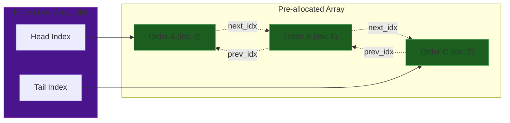
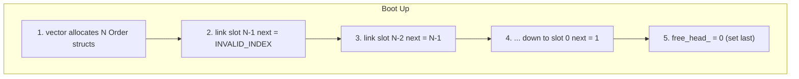

# Deep-Dive Architecture & Memory Layout

## 1. Data Structure Justifications

High-Frequency Trading matching engines cannot afford the unpredictability of generic standard library containers. Below is a formal complexity justification for the fundamental components of our architecture.

### Price Levels: Flat Array vs. `std::map`

| Operation | `std::map<Price, PriceLevel>` | `std::vector<PriceLevel>` (Our Engine) |
| :--- | :--- | :--- |
| **Lookup** | $O(\log N)$ | $O(1)$ |
| **Insertion** | $O(\log N)$ + heap allocation | $O(1)$ |
| **Deletion** | $O(\log N)$ + heap free | $O(1)$ |
| **Cache Behavior** | Very Poor (Pointer Chasing) | Excellent (Contiguous) |

**Rationale:** `std::map` relies on Red-Black Trees. Navigating to the Best Bid requires traversing pointers scattered randomly across the heap, guaranteeing L3 cache misses. By constraining prices within `[min_price, max_price]`, we map Price strings directly to array offsets `array[price - min_price]`. The cost of reserving a large memory block upfront is completely offset by the $O(1)$ constant-time lookup.

### Order Tracking: `unordered_map` vs. Flat Array

**Rationale:** While `std::unordered_map` claims $O(1)$ amortized lookup, it uses separate chaining (linked lists) to resolve bucket collisions. This means dynamically allocating memory upon hash conflicts. Our engine replaces this with a simple `std::vector<uint32_t> order_map_`. A lookup is just an array read: `order_pool_.data()[order_map_[order_id]]`.

---

## 2. Intrusive Doubly-Linked Lists

To maintain Price-Time priority without dynamic memory churn, Orders represent nodes in an intrusive doubly-linked list.

When an order is cancelled, we grab the index from `order_map_` in $O(1)$, and immediately detach it from the list in $O(1)$ by connecting `pool_data[order.prev].next` to `pool_data[order.next].prev`.

---

## 3. Memory Pool Mechanics

The core rule of C++ HFT engines is **Zero Dynamic Allocation on the Critical Path**. The `MemoryPool<Order>` implements this.

### State Overview

The `MemoryPool` pre-allocates an array of `N` `Order` structs inside a single contiguous `std::vector`. On startup, it stitches them into a LIFO stack.

The free-list link is overlaid on the **first 4 bytes** of each slot
(`Order::next`), accessed through `std::memcpy` so there is no
strict-aliasing violation. The constructor walks the slots top-down, so
the chain is built in descending index order and `free_head_` ends up
pointing at slot 0 — the opening burst of allocations therefore gets
ascending, cache-friendly indices.

### Allocation Flow ($O(1)$)
When an order arrives, `engine` calls `pool.allocate()`:
1. `idx = free_head_`
2. `free_head_ = overlay_link(pool[idx])` (Advances stack)
3. In Debug/Audit: the allocation stamp flips `allocated_[idx] = 1`
4. Returns `idx`.

### Deallocation Flow & Double-Free Protection
When an order executes or cancels:
1. Engine calls `pool.deallocate(idx)`
2. **Debug/Audit:** checks bounds `idx < capacity()` and the slot's state
   stamp. A double free, a wild free or an out-of-range index invokes the
   installed fault handler; with no handler installed, the pool prints a
   diagnostic and aborts deterministically. This is vital because
   double-frees corrupt the LIFO structure, causing two clients to own
   the same memory address.
3. **Debug/Audit:** flips `allocated_[idx] = 0`.
4. Pushes back to stack: `overlay_link(pool[idx]) = free_head_; free_head_ = idx;`

**Release** compiles the guards out entirely: the index must come from
book state. The Audit flavor exists to verify that invariant, and CI
runs it before any Release artifact ships.

This technique completely bypasses the OS `malloc`/`free` global locks: the free-list head and the slot index are the only two values the hot path touches, and the links themselves live in the pool's own memory.
